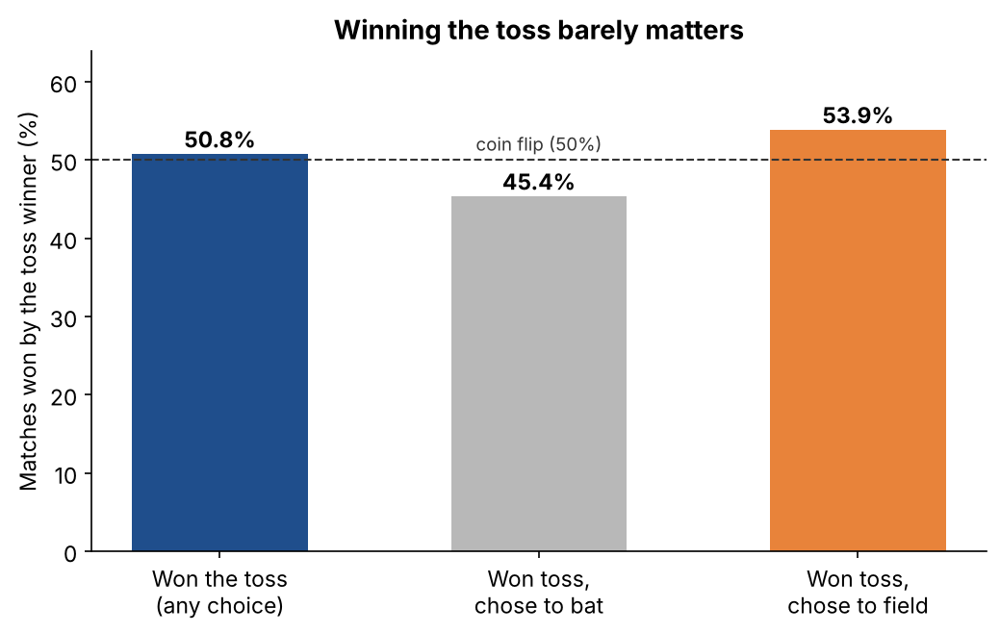
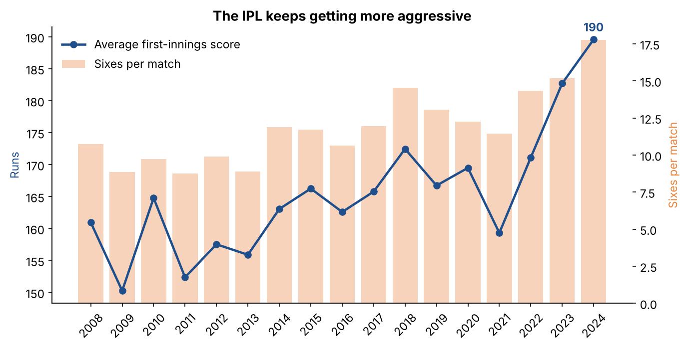
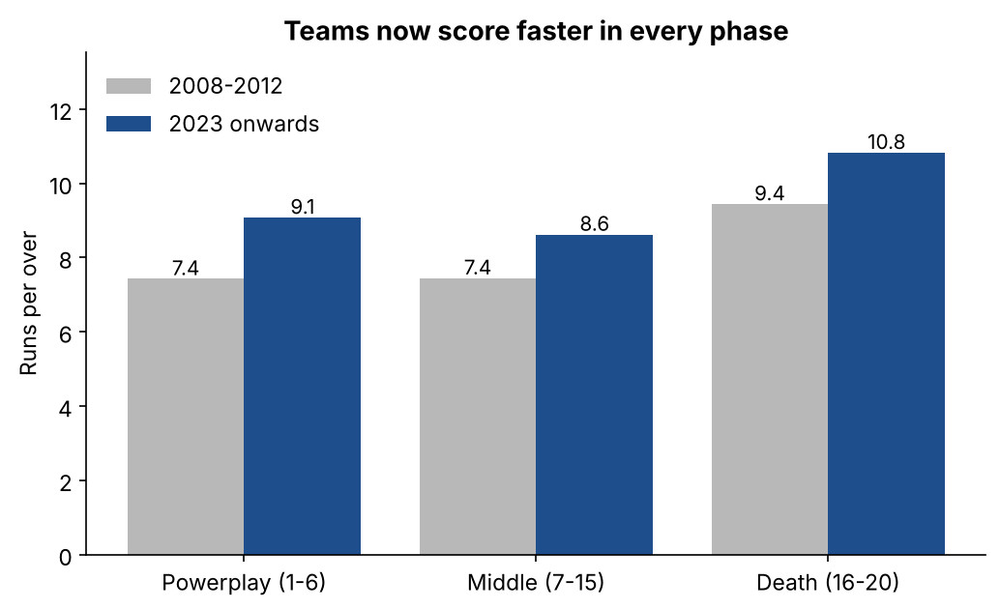
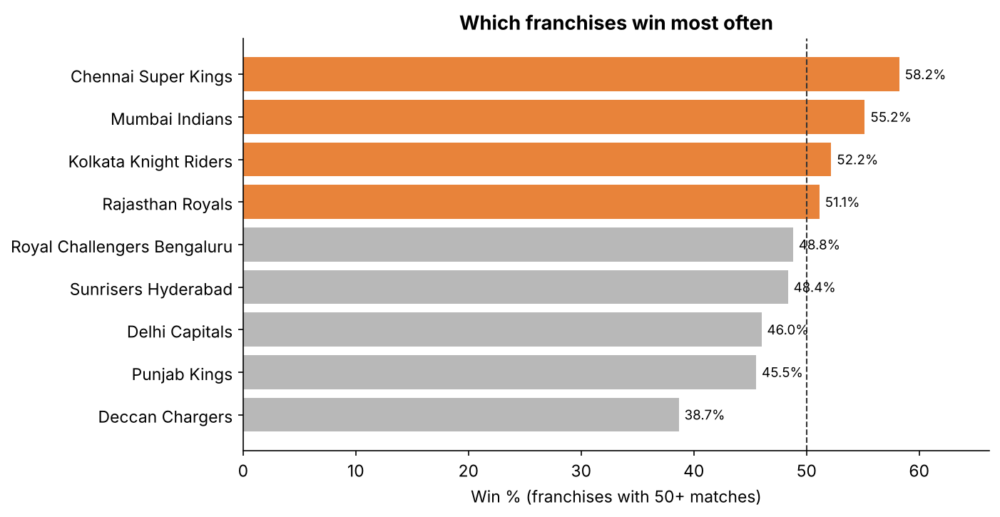
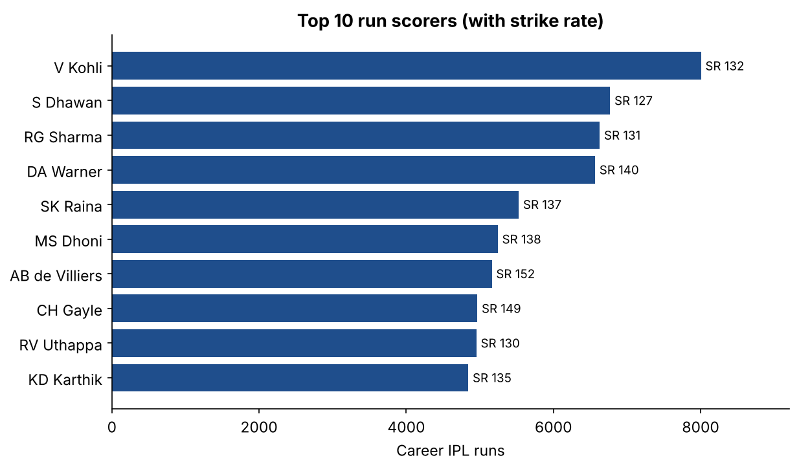

# IPL Cricket Analysis with SQL

**Does winning the toss actually help you win an IPL match?**
This project answers that and 13 other cricket questions using SQL on **real ball-by-ball data from every IPL season, 2008–2024**: 1,095 matches and 260,920 deliveries.



---

## Key findings

**1. The toss barely matters.** Toss winners won **50.8%** of matches, almost a coin flip. What matters more is the *choice*: teams that chose to field won **53.9%**, while teams that chose to bat won only **45.4%**. Overall, chasing teams win **54.3%** of IPL matches.

**2. The IPL keeps getting more aggressive.** The average first-innings score rose from **161 in 2008 to 190 in 2024**, and sixes per match went from **10.7 to 17.8**. The sharpest jump came in 2023–24.



**3. Teams score faster in every phase.** Compared with 2008–2012, run rates since 2023 are higher in the powerplay (**7.4 → 9.1** per over), the middle overs (**7.4 → 8.6**) and the death overs (**9.4 → 10.8**). **9 of the 10 highest team totals ever** came in 2023 or 2024, led by Sunrisers Hyderabad's **287** against RCB.



**4. Consistency wins titles.** Chennai Super Kings have the best win rate of any franchise (**58.2%**). CSK and Mumbai Indians have won **5 titles each**.



**5. Kohli leads the run charts.** Virat Kohli is the top run scorer with **8,004 runs**, and his **973 runs in 2016** are the most by anyone in a single season. AB de Villiers has the highest strike rate in the top 10 (**152**) and the most Player of the Match awards (**25**).



**6. Where to chase.** Chasing is easiest at Sawai Mansingh Stadium, Jaipur (**64.9%** chasing wins) and hardest at Chennai's MA Chidambaram Stadium (**43.4%**), where batting first is the better bet.

---

## Database design

5 tables and 1 view:

| Table | Rows | What it holds |
|---|---|---|
| `teams` | 15 | Franchises, using their current names |
| `venues` | 37 | Grounds and their cities |
| `players` | 732 | Every batter, bowler and dismissed player |
| `matches` | 1,095 | One row per match: season, teams, toss, result, Player of the Match |
| `deliveries` | 260,920 | One row per ball: batter, bowler, runs, extras, wickets |
| `v_balls` (view) | – | Every ball with names, season, phase, and flags for legal balls and bowler wickets |

**Data cleaning in `load_data.py`:**
- Renamed franchises are joined up: Delhi Daredevils → Delhi Capitals, Kings XI Punjab → Punjab Kings, Royal Challengers Bangalore → Bengaluru
- Season labels like "2007/08" are converted to the IPL year (2008)
- Different spellings of the same ground are merged (e.g. Feroz Shah Kotla → Arun Jaitley Stadium)
- Overs are stored as 1–20; super overs are excluded from the statistics

**Cricket rules built into the view:**
- Wides don't count as balls faced by the batter
- Wides and no-balls aren't legal deliveries for the bowler
- Byes and leg-byes aren't charged to the bowler
- Run outs aren't credited to the bowler as wickets

## The 14 questions ([`queries.sql`](queries.sql))

| # | Question | SQL used |
|---|---|---|
| Q1 | Does winning the toss help you win? | conditional aggregation |
| Q2 | Should the toss winner bat or field? | `GROUP BY` |
| Q3 | Batting first vs chasing, season by season | `CASE` logic, `AVG` |
| Q4 | Which franchises win most often? | CTE with `UNION ALL`, `HAVING` |
| Q5 | Who won each season? | multiple joins |
| Q6 | Top 10 run scorers of all time | aggregates on the view |
| Q7 | Orange Cap: top scorer each season | window function (`ROW_NUMBER() OVER PARTITION BY`) |
| Q8 | Top 10 wicket takers | aggregates, economy rate |
| Q9 | Best death-over bowlers | filters, `HAVING` minimum balls |
| Q10 | Is the IPL getting more aggressive? | CTE, innings-level totals |
| Q11 | Run rate by phase, early vs recent | conditional sums |
| Q12 | Most Player of the Match awards | `GROUP BY`, `ORDER BY` |
| Q13 | Highest team totals ever | multi-level grouping |
| Q14 | Venues where chasing is easiest | joins, `HAVING` |

Every result is in [`query_results.md`](query_results.md).

---

## Files

| File | What it is |
|---|---|
| `ipl.db` | The ready-to-use SQLite database |
| `schema.sql` | Tables, keys, indexes and the `v_balls` view |
| `queries.sql` | The 14 questions |
| `query_results.md` | Results of every query |
| `load_data.py` | Cleans the raw CSVs and loads them into `ipl.db` |
| `run_reports.py` | Runs all queries and refreshes `query_results.md` |
| `make_charts.py` | Draws the five charts |
| `matches.csv`, `deliveries.csv.zip` | Raw data (deliveries zipped to fit GitHub's upload limit) |
| `chart_*.png` | The charts |

## How to run

**No coding:** download `ipl.db`, open it in [DB Browser for SQLite](https://sqlitebrowser.org/), go to **Execute SQL**, paste any query from `queries.sql` and press Run.

**With Python:**
```bash
pip install -r requirements.txt
python load_data.py       # rebuild ipl.db from the raw files (optional)
python run_reports.py     # answer all 14 questions
python make_charts.py     # redraw the charts
```

---

## What I learned

- **Cleaning matters more than querying.** Team renames and inconsistent ground names would have split one franchise's history into several, so fixing them first made every answer correct.
- **Domain rules belong in the data model.** Putting cricket rules (wides, no-balls, run outs) into one view meant every query used the same correct logic.
- **Data can settle debates.** "Win the toss and you win the match" sounds true, but across 1,090 results it's almost exactly 50/50.

---

**Data source:** [IPL Complete Dataset (2008–2024)](https://www.kaggle.com/datasets/patrickb1912/ipl-complete-dataset-20082020) by Patrick B on Kaggle.

**Mohd Areeb Alam** · B.Tech, NSUT (2027) · [LinkedIn](https://www.linkedin.com/in/mohd-areeb-alam-9ba28822a/) · [GitHub](https://github.com/areebalam49-lgtm)
